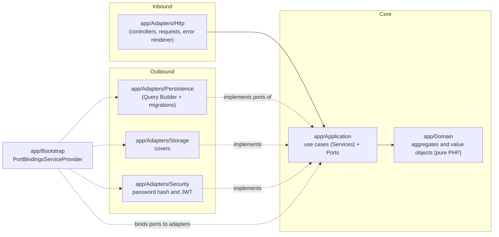
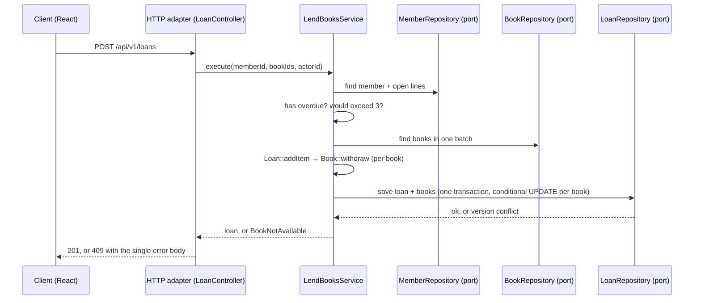

# Architecture — Manager Library (PHP 8.3 / Laravel + React)

Translation of [`../spec-python/architecture.md`](../spec-python/architecture.md). It is a **hexagonal** architecture (ports and adapters).
The dependency rules are Articles I to III of [`constitution.md`](constitution.md).

## 1. Layers and dependencies



Dependency arrows point **inward**. `app/Bootstrap` is the only place that sees both halves.

## 2. Folder structure (backend, `api` repository)

```text
app/
├── Domain/                       # Book, Loan, LoanItem, Member, User; Isbn, Quantity, DocumentNumber, DateRange
│                                 # pure PHP 8.3, readonly, no Illuminate\*
├── Application/
│   ├── Ports/                    # interfaces only, no framework types in signatures
│   │                             # BookRepository, LoanRepository, MemberRepository, UserRepository,
│   │                             # ReportReader, Clock, PasswordHasher, TokenIssuer, CoverStorage
│   └── Services/                 # LendBooksService, ReturnItemService, CreateBookService, SearchBooksService,
│                                 # OverdueService, MostBorrowedReportService, LoginService, CreateLibrarianService
├── Adapters/
│   ├── Http/                     # controllers, form requests, route middleware (role checks), error renderer
│   ├── Persistence/              # Query Builder repositories on schema "library"
│   ├── Storage/                  # CoverStorage implementation (local disk; S3 later)
│   └── Security/                 # PasswordHasher (password_hash Argon2id), TokenIssuer (firebase/php-jwt), SystemClock
└── Bootstrap/
    └── PortBindingsServiceProvider.php   # the single composition point (Article III)

database/migrations/              # all DDL: schema library, six tables, FKs, indexes, CHECKs, category seed
routes/api.php                    # prefix /api/v1
tests/
├── Unit/Domain/                  # invariants with a fake clock
├── Unit/Application/             # use cases with in-memory fakes of the ports
├── Feature/                      # HTTP contract tests against the API
├── Integration/                  # repositories and report query on real PostgreSQL 16
└── Architecture/                 # deptrac or scan rules for Articles I to III
```

Note on `app/Application/Services`: Laravel does not ship a "service" concept, so the name is a project convention. Each class is one use case (Article IV).

## 3. Aggregates

| Root | Contains | Invariants it defends |
|---|---|---|
| `Book` | `Isbn`, total and available copies, soft-delete flag | available between 0 and total; total ≥ 1; title not empty |
| `Loan` | collection of `LoanItem` | 1 to 3 lines; no repeated book; 14-day due date; immutable except for a return |
| `Member` | document number | document required and unique (enforced by a `UNIQUE` in the database too) |
| `User` | role, password hash | normalized username; role in (`admin`, `librarian`) |

`Loan::addItem()` calls `Book::withdraw()` before adding the line: taking the copy and creating the line are **one operation**.
`Loan::returnItem()` calls `Book::restock()` once per line.

## 4. Flow: register a loan



## 5. Errors

The domain and the application throw their own exceptions (`BookNotAvailable`, `MemberHasOverdue`, `MemberLimitExceeded`, …).
**Only** the HTTP adapter translates them into the single error body and the status code of
[`../spec-python/api-contract.md`](../spec-python/api-contract.md). A framework error (`ModelNotFoundException`, `QueryException`, validation exception)
never reaches the client as is: the exception handler in `app/Adapters/Http` maps it to the contract.

## 6. Frontend (`app` repository)

```text
src/
├── api/            # one fetch client: base URL from VITE_API_URL, bearer token, error body parsing
├── auth/           # login state, role checks for the menu
├── pages/          # Login, Books, Members, LendBooks, Loans, Returns, Overdue, Report, NewLibrarian
├── components/     # tables, pagination, forms, alerts
└── main.jsx        # router and providers
```

The frontend talks to the API **only** over HTTP, with the contract above. It does not know the database or the Laravel code.
Route guards use the role returned by `POST /auth/login`. Screen texts are in Spanish.

## 7. What is not there

No events, no queues, no cache, no microservices, no multi-tenancy, no Eloquent models in the domain or the application layer.
They are added only when a requirement asks for them.
